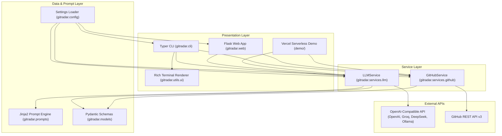
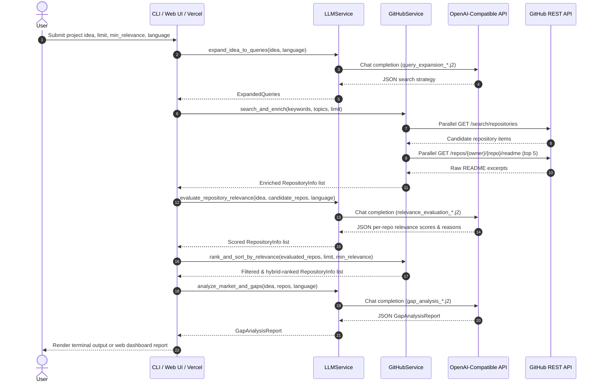

# GitRadar Technical Architecture

This document specifies the subsystem boundaries, data schemas, execution sequence, and fault-handling mechanics of GitRadar.

## Table of Contents

- [Architectural Pattern](#architectural-pattern)
- [Subsystem Specifications](#subsystem-specifications)
- [End-to-End Sequence Flow](#end-to-end-sequence-flow)
- [Hybrid Relevance Scoring Formula](#hybrid-relevance-scoring-formula)
- [Error and Exception Matrix](#error-and-exception-matrix)

---

## Architectural Pattern

GitRadar uses a four-layer decoupled architecture separating presentation interfaces, domain services, prompt templates and data models, and external REST APIs.

---

## Subsystem Specifications

### 1. Presentation Layer
- **CLI (`gitradar/cli.py`)**: Built with `typer`. Exposes `analyze`, `search`, `ui`, `config`, and `version` subcommands. Bridges synchronous CLI entrypoints to async HTTP operations via `asyncio.run()`.
- **Local Web UI (`gitradar/web/app.py`)**: Built with `flask`. Exposes `GET /`, `GET /api/config`, `POST /api/analyze`, and `POST /api/search`. Uses `safe_run_async()` to execute coroutines cleanly even when an event loop is already active.
- **Vercel Serverless Demo (`demo/`)**: Packages the Flask app under `demo/api/index.py` and static assets under `demo/public/`. Synchronized from the primary package via `make sync-demo`. Accepts per-request credentials via `X-OpenAI-Api-Key`, `X-OpenAI-Base-Url`, `X-Groq-Api-Key`, and `X-Github-Token` headers.
- **Terminal Renderer (`gitradar/utils/ui.py`)**: Built with `rich`. Formats query strategies, repository ranking tables, saturation gauges, and implementation guides.

### 2. Service Layer
- **GitHub Service (`gitradar/services/github.py`)**:
  - Executes parallel `GET /search/repositories` queries across expanded keywords and filtered topics via `asyncio.gather()`.
  - Deduplicates repositories by `full_name` and sorts initial candidates by `(stars, forks, full_name)`.
  - Fetches raw README excerpts (`first 800 characters`) for the top 5 repositories via `GET /repos/{owner}/{repo}/readme`.
  - Computes hybrid relevance scores and enforces minimum relevance filtering in `rank_and_sort_by_relevance()`.
- **LLM Service (`gitradar/services/llm.py`)**:
  - Wraps `openai.OpenAI` with automatic endpoint routing: keys prefixed with `gsk_` or configured via `GROQ_API_KEY` automatically target `https://api.groq.com/openai/v1` and default to `llama-3.3-70b-versatile`.
  - Allows keyless execution when `base_url` targets `localhost`, `127.0.0.1`, or `0.0.0.0` for local inference servers (Ollama, vLLM, LM Studio).
  - Implements multi-model fallback chains and dual-mode JSON completion (`response_format={"type": "json_object"}` followed by raw text extraction via `extract_json()`).

### 3. Data Schemas (`gitradar/models.py`)

| Model | Primary Fields | Purpose |
| :--- | :--- | :--- |
| `RepositoryInfo` | `full_name`, `stars`, `forks`, `topics`, `readme_snippet`, `relevance_score`, `hybrid_score` | Normalized GitHub repository metadata and relevance scoring metrics |
| `ExpandedQueries` | `search_keywords`, `github_topics`, `target_languages`, `search_explanation` | LLM-derived search query strategy |
| `CompetitorSummary` | `repo_name`, `key_strengths`, `weaknesses_or_gaps` | Per-repository competitive analysis |
| `OpenSourceTool` | `name`, `category`, `description_and_usage`, `repo_url` | Recommended open-source package or library |
| `ImplementationGuide` | `recommended_tech_stack`, `architecture_overview`, `open_source_building_blocks` | Actionable architecture blueprint for building the project |
| `GapAnalysisReport` | `idea_summary`, `market_saturation`, `saturation_score`, `opportunity_score`, `top_competitors`, `unmet_needs`, `differentiators`, `actionable_recommendations`, `implementation_guide` | Complete market and gap report returned to CLI and Web UI |

### 4. Prompt Engine (`gitradar/prompts/`)
Uses `jinja2.Environment` with `FileSystemLoader` across three template pairs:
- `query_expansion_system.j2` and `query_expansion_user.j2`
- `relevance_evaluation_system.j2` and `relevance_evaluation_user.j2`
- `gap_analysis_system.j2` and `gap_analysis_user.j2`

---

## End-to-End Sequence Flow

---

## Hybrid Relevance Scoring Formula

To prevent high-star but tangentially related repositories from crowding out direct competitors, `GitHubService.rank_and_sort_by_relevance` calculates a composite `hybrid_score` on a `0` to `100` scale:

$$\text{star\_score} = \min\left(100.0, \frac{\log_{10}(\text{stars} + 1)}{\log_{10}(\max(\text{max\_stars}, 10) + 1)} \times 100.0\right)$$

$$\text{hybrid\_score} = \text{round}\left(0.7 \times \text{relevance\_score} + 0.3 \times \text{star\_score}, 1\right)$$

Repositories with `relevance_score < min_relevance` are removed. If no repository satisfies `min_relevance`, a fallback threshold of `max(30, min_relevance - 20)` is applied before sorting descending by `(hybrid_score, stars, forks, full_name)`.

---

## Error and Exception Matrix

| Failure Mode | Component | Handling Strategy |
| :--- | :--- | :--- |
| Missing AI API key on remote endpoint | `LLMService._ensure_api_key` | Raises `ValueError` instructing the user to run `gitradar config --openai-api-key` or populate the Web UI Settings modal. |
| Invalid or expired AI API key (`401`) | `LLMService._completion_with_fallback` | Catches `AuthenticationError` immediately without retrying fallback models and raises a descriptive `ValueError`. |
| Provider rejects `response_format` JSON mode | `LLMService._completion_with_fallback` | Retries completion without `response_format`, strips `<think>` tags and code fences, and parses via `extract_json()`. |
| Trailing commas in LLM JSON output | `extract_json` | Applies regex sanitization `re.sub(r",\s*([\}\]])", r"\1", cleaned)` before re-parsing with `json.loads()`. |
| GitHub REST API rate limit exceeded (`403`) | `GitHubService.search_repositories` | Raises `RuntimeError` instructing the user to configure `GITHUB_TOKEN`. |
| Active asyncio event loop in web server | `gitradar.web.app.safe_run_async` | Detects running event loop via `asyncio.get_running_loop()` and dispatches coroutine execution to a single-worker `ThreadPoolExecutor`. |
