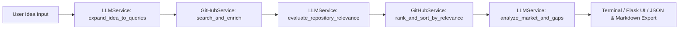

# GitRadar

<p align="center">
  
</p>

<p align="center">
  <b>GitHub market and gap analysis CLI, Flask web dashboard, and Python SDK backed by the GitHub REST API and OpenAI-compatible LLMs.</b>
</p>

<p align="center">
  <a href="https://github.com/AtaCanYmc/GitRadar/actions/workflows/ci.yml"></a>
  <a href="https://pypi.org/project/gitradar/"></a>
  <a href="https://pypi.org/project/gitradar/"></a>
  <a href="./LICENSE"></a>
  <a href="https://vercel.com/new/clone?repository-url=https%3A%2F%2Fgithub.com%2FAtaCanYmc%2FGitRadar&root-directory=demo"></a>
</p>

---

## Table of Contents

- [Overview](#overview)
- [System Architecture](#system-architecture)
- [Quick Start and Installation](#quick-start-and-installation)
- [Configuration and Environment Schema](#configuration-and-environment-schema)
- [CLI Reference](#cli-reference)
- [Web Dashboard and Serverless Demo](#web-dashboard-and-serverless-demo)
- [Python SDK Usage](#python-sdk-usage)
- [Repository Layout](#repository-layout)
- [Testing and Verification](#testing-and-verification)
- [Frequently Asked Questions](#frequently-asked-questions)
- [Documentation Index](#documentation-index)
- [License](#license)

---

## Overview

GitRadar evaluates software project ideas against existing open-source repositories on GitHub. Given a natural-language concept, it executes a four-stage analysis pipeline:

1. **Query Expansion**: Converts the raw idea into search keywords, target languages, and GitHub topic filters using Jinja2 prompt templates.
2. **Concurrent GitHub Discovery**: Queries `GET /search/repositories` concurrently via `httpx.AsyncClient`, deduplicates results, and enriches top candidates with `GET /repos/{owner}/{repo}/readme` snippets.
3. **Hybrid Relevance Ranking**: Scores each candidate repository for semantic fit (`0` to `100`), computes a hybrid score combining LLM relevance (`70%`) and log-normalized star count (`30%`), and filters results below the configured threshold.
4. **Gap and Architecture Synthesis**: Produces a structured `GapAnalysisReport` containing market saturation metrics, competitor strengths and gaps, unmet user needs, differentiators, recommended tech stack, and open-source building blocks.

---

## System Architecture



---

## Quick Start and Installation

### Install from PyPI

```bash
pip install gitradar
```

### Install from Source

```bash
git clone https://github.com/AtaCanYmc/GitRadar.git
cd GitRadar
python3 -m venv .venv
source .venv/bin/activate
pip install -e ".[dev]"
```

### Configure Credentials and Run Analysis

```bash
# 1. Configure an OpenAI-compatible API key (or copy .env.example to .env)
gitradar config --openai-api-key "sk-your_api_key_here"

# 2. Optional: configure a GitHub token to raise rate limits from 60 to 5,000 requests/hour
gitradar config --github-token "ghp_your_github_token_here"

# 3. Run terminal market and gap analysis
gitradar analyze "AI code review tool for git hooks"
```

---

## Configuration and Environment Schema

GitRadar reads configuration from `~/.config/gitradar/config.env`, a local `.env` file (see [`.env.example`](./.env.example)), or environment variables. It connects to any OpenAI-compatible endpoint including OpenAI, Groq, DeepSeek, OpenRouter, Ollama, and vLLM.

| Variable | Type | Default | Required | Description |
| :--- | :--- | :--- | :---: | :--- |
| `OPENAI_API_KEY` | String | `None` | Yes* | Primary API key for OpenAI or any OpenAI-compatible provider. *Not required for local `localhost` endpoints or when `GROQ_API_KEY` is set. |
| `OPENAI_BASE_URL` | String (URL) | `https://api.openai.com/v1` | No | Custom OpenAI-compatible base URL. Automatically defaults to `https://api.groq.com/openai/v1` when a `gsk_` key is used. |
| `GROQ_API_KEY` | String | `None` | No | Fallback Groq API key. Routes requests to the Groq OpenAI endpoint. |
| `GITHUB_TOKEN` | String | `None` | No | GitHub Personal Access Token. Increases GitHub Search and REST API limits. |
| `DEFAULT_MODEL` | String | `gpt-4o-mini` | No | Default model identifier. Auto-switches to `llama-3.3-70b-versatile` on Groq endpoints. |
| `DEFAULT_LANGUAGE` | String | `English` | No | Output language for LLM analysis reports (`English`, `Turkish`, `Spanish`, `German`, `French`). |
| `MAX_REPOS_TO_ANALYZE` | Integer | `50` | No | Upper bound on candidate repositories evaluated per run. |
| `MIN_RELEVANCE_THRESHOLD` | Integer | `50` | No | Minimum relevance percentage (`0` to `100`) required for a repository to pass filtering. |

### Provider Configuration Examples

```bash
# Groq
gitradar config --openai-api-key "gsk_..." --base-url "https://api.groq.com/openai/v1" --model "llama-3.3-70b-versatile"

# DeepSeek
gitradar config --openai-api-key "sk-..." --base-url "https://api.deepseek.com" --model "deepseek-chat"

# Local Ollama (no API key required)
gitradar config --base-url "http://localhost:11434/v1" --model "llama3.2"

# Inspect saved configuration
gitradar config --show
```

---

## CLI Reference

### `gitradar analyze <IDEA>`

Runs the full query expansion, GitHub search, hybrid relevance filtering, and gap analysis pipeline.

```bash
gitradar analyze "Terminal log viewer for Kubernetes pods" --limit 10 --min-relevance 60 --lang English
```

| Option / Flag | Short | Type | Default | Description |
| :--- | :---: | :--- | :--- | :--- |
| `--limit` | `-l` | Integer | `10` | Maximum repositories to retain after relevance ranking. |
| `--min-relevance` | `-r` | Integer | `50` | Minimum relevance score threshold (`0` to `100`). |
| `--model` | `-m` | String | `None` | Override configured LLM model identifier for this invocation. |
| `--api-key` | `-k` | String | `None` | Override configured API key for this invocation. |
| `--base-url` | `-u` | String | `None` | Override OpenAI-compatible base URL for this invocation. |
| `--lang`, `--language` | None | String | `None` | Override output language for the generated report. |

### `gitradar search <QUERY>`

Executes a direct GitHub repository search without invoking an LLM.

```bash
gitradar search "terminal devtools" --limit 5 --sort stars
```

| Option / Flag | Short | Type | Default | Description |
| :--- | :---: | :--- | :--- | :--- |
| `--limit` | `-l` | Integer | `10` | Maximum repositories to return. |
| `--sort` | `-s` | String | `stars` | GitHub sort key (`stars`, `forks`, `updated`). |

### `gitradar ui`

Starts the local Flask web dashboard.

```bash
gitradar ui --host 127.0.0.1 --port 5000
```

| Option / Flag | Short | Type | Default | Description |
| :--- | :---: | :--- | :--- | :--- |
| `--port` | `-p` | Integer | `5000` | TCP port to bind the local Flask server. |
| `--host` | `-h` | String | `127.0.0.1` | Host interface address to bind. |
| `--open / --no-open` | None | Boolean | `true` | Automatically open the dashboard URL in the default browser. |

### `gitradar config`

Reads or persists user configuration values in `~/.config/gitradar/config.env`.

| Option / Flag | Short | Type | Default | Description |
| :--- | :---: | :--- | :--- | :--- |
| `--show` | None | Boolean | `false` | Print current masked configuration table. |
| `--openai-api-key` | `-k` | String | `None` | Save `OPENAI_API_KEY` to user config. |
| `--base-url` | `-u` | String | `None` | Save `OPENAI_BASE_URL` to user config. |
| `--groq-api-key` | None | String | `None` | Save legacy `GROQ_API_KEY` to user config. |
| `--github-token` | None | String | `None` | Save `GITHUB_TOKEN` to user config. |
| `--model` | None | String | `None` | Save `DEFAULT_MODEL` to user config. |
| `--lang`, `--language` | None | String | `None` | Save `DEFAULT_LANGUAGE` to user config. |

---

## Web Dashboard and Serverless Demo

- **Local Web UI (`gitradar ui`)**: Serves an interactive dashboard at `http://127.0.0.1:5000` with `/api/analyze`, `/api/search`, and `/api/config` endpoints, dark/light theme toggle, English/Turkish UI localization, in-browser settings modal, and Markdown/JSON report downloads.
- **Serverless Vercel Demo ([`demo/`](./demo/README.md))**: Standalone Vercel deployment target. User API keys remain in browser `localStorage` and are sent per request via HTTPS headers (`X-OpenAI-Api-Key`, `X-OpenAI-Base-Url`, `X-Groq-Api-Key`, `X-Github-Token`).

---

## Python SDK Usage

Import `GitHubService` and `LLMService` directly into Python applications:

```python
import asyncio
from gitradar.services.github import GitHubService
from gitradar.services.llm import LLMService


async def main() -> None:
    idea = "Automated docstring and governance generator"

    github_service = GitHubService()
    llm_service = LLMService(language="English")

    queries = llm_service.expand_idea_to_queries(idea)
    raw_repos = await github_service.search_and_enrich(
        keywords=queries.search_keywords,
        topics=queries.github_topics,
        limit=10,
    )
    evaluated = llm_service.evaluate_repository_relevance(idea, raw_repos)
    ranked_repos = github_service.rank_and_sort_by_relevance(
        evaluated, limit=5, min_relevance=50
    )

    report = llm_service.analyze_market_and_gaps(idea, ranked_repos)
    print(f"Saturation: {report.market_saturation} ({report.saturation_score}/100)")
    print(f"Opportunity Score: {report.opportunity_score}/100")


asyncio.run(main())
```

---

## Repository Layout

```text
GitRadar/
├── .env.example                 # Environment variable template
├── ARCHITECTURE.md              # Component architecture, sequence flow, and error matrix
├── CHANGELOG.md                 # Automated semantic release history
├── CODE_OF_CONDUCT.md           # Contributor Covenant code of conduct
├── CONTRIBUTING.md              # Development setup, testing, and commit standards
├── LICENSE                      # MIT License
├── Makefile                     # Development, testing, and demo synchronization targets
├── ROADMAP.md                   # Versioned milestone tracker
├── SECURITY.md                  # Vulnerability disclosure policy and response SLA
├── pyproject.toml               # Package build manifest and dependencies
├── assets/
│   └── gitradar-logo.png        # Square repository logo icon
├── demo/                        # Standalone Vercel serverless web demo
│   ├── README.md                # Scoped documentation for Vercel deployment
│   ├── api/index.py             # Vercel WSGI serverless entrypoint
│   ├── gitradar/                # Synchronized core package for serverless packaging
│   ├── public/                  # Static frontend HTML, CSS, JS, and icons
│   ├── requirements.txt         # Runtime dependencies for Vercel Python builder
│   └── vercel.json              # Vercel routing manifest
├── examples/                    # SDK and shell automation recipes
│   ├── README.md                # Scoped documentation for usage scripts
│   ├── batch_analyze_ideas.sh   # Sequential batch analysis script
│   ├── ci_market_check.sh       # CI pipeline market check script
│   ├── python_sdk_usage.py      # Runnable Python SDK script
│   └── sample_gap_report.json   # Reference JSON output schema
├── gitradar/                    # Primary Python package
│   ├── __init__.py              # Package version export
│   ├── cli.py                   # Typer CLI commands and argument definitions
│   ├── config.py                # Pydantic settings loader and ~/.config persistence
│   ├── models.py                # Pydantic data schemas
│   ├── prompts/                 # Jinja2 system and user prompt templates
│   ├── services/                # Async GitHub REST client and OpenAI-compatible LLM client
│   ├── utils/ui.py              # Rich terminal tables and report renderers
│   └── web/                     # Flask web application, HTML templates, and static assets
└── tests/                       # Pytest unit and integration suite
```

---

## Testing and Verification

Execute the automated test suite via `pytest` or `Makefile`:

```bash
pytest -v
```

---

## Frequently Asked Questions

#### Does GitRadar transmit API keys or project ideas to a middleman server?
No. When running the CLI or local web dashboard, GitRadar connects directly from your machine to `api.github.com` and your configured `OPENAI_BASE_URL`. In the Vercel demo (`demo/`), user keys are kept in browser `localStorage` and passed per request without server persistence.

#### Can GitRadar run offline or without paid API keys?
GitRadar requires internet access to query the GitHub REST API (`api.github.com`), which works anonymously up to 60 requests per hour or up to 5,000 requests per hour with a free `GITHUB_TOKEN`. For LLM inference, you can run a local model server such as Ollama (`http://localhost:11434/v1`) with zero external API cost.

#### How does GitRadar handle LLM providers that reject `response_format={"type": "json_object"}`?
`LLMService._completion_with_fallback` attempts structured JSON mode first. If the upstream endpoint rejects `response_format`, it retries with standard text completion, strips `<think>...</think>` reasoning tags and markdown code fences, and extracts the outermost JSON object via `extract_json()`.

---

## Documentation Index

- [ARCHITECTURE.md](./ARCHITECTURE.md): Subsystem architecture, data schemas, prompt engine, and error handling matrix.
- [ROADMAP.md](./ROADMAP.md): Shipped release history and planned v0.2.0 / v0.3.0 milestones.
- [CONTRIBUTING.md](./CONTRIBUTING.md): Local setup, test execution, demo synchronization, and Conventional Commits guide.
- [SECURITY.md](./SECURITY.md): Supported versions, private vulnerability reporting, and credential isolation model.
- [CODE_OF_CONDUCT.md](./CODE_OF_CONDUCT.md): Community participation standards.
- [CHANGELOG.md](./CHANGELOG.md): Version-by-version release notes.
- [demo/README.md](./demo/README.md): Scoped deployment and architecture guide for the Vercel serverless demo.
- [examples/README.md](./examples/README.md): Scoped guide for SDK scripts, shell pipelines, and sample JSON schemas.

---

## License

Released under the [MIT License](./LICENSE).
